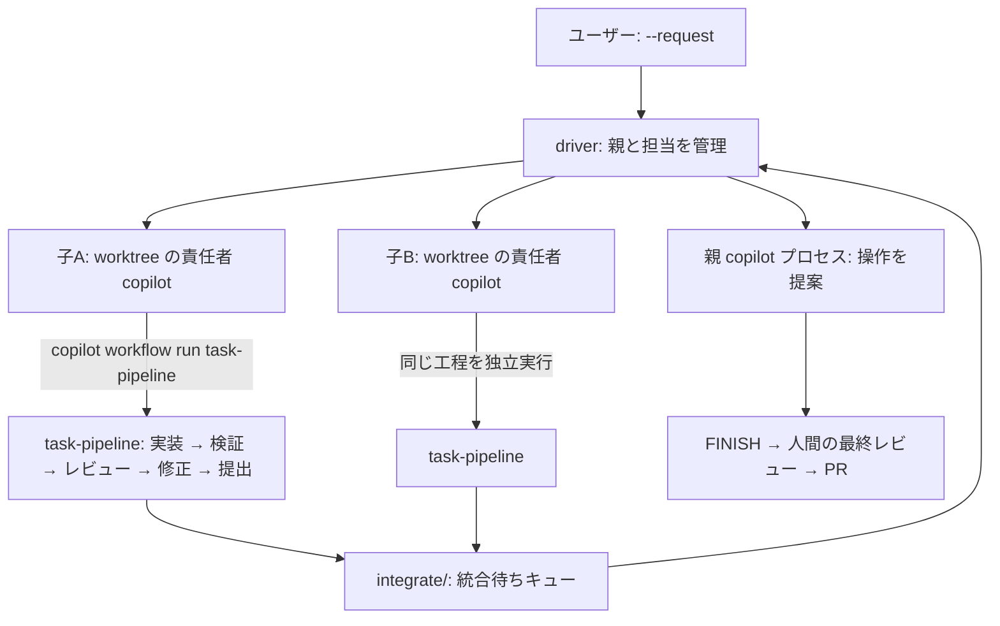

# CLI-ENTRY — CLI 入口（driver から子の工程を回す）の実装指示

この文書は、**前の会話を引き継がない新しいAIセッション**に、CLI 入口の実装をさせるための指示書です。
App 入口（`.github/skills/parallel-dev-orchestration/SKILL.md` と子セッションの `task-pipeline`）で
定義したのと同じ流れを、CLI だけで回せるようにします。

依頼者が新しいセッションへ渡す短い指示:

> このリポジトリの `.github/extensions/integrate-task/docs/CLI-ENTRY.md` を読み、記載された実装を実施してください。

準備担当の会話ログや完成版は渡されません。書かれていないことは自分で調べて判断し、根拠を記録してください。

## 1. 目的と分担

| 図の役割 | CLI での実体 |
| --- | --- |
| ユーザー（目的・制約・優先順位） | `--request` / `--request-file` で driver に渡す依頼文 |
| 親セッション（全体のオーケストレーター） | driver が起動する親 `copilot` プロセス。`agent-operation` フェンスで DISPATCH / ANSWER / REWORK / CHECK_MERGE / APPLY_MERGE / REQUEST_HUMAN / FINISH を提案する |
| 子A・子B（専用 worktree／専用ブランチの責任者） | driver が worktree ごとに起動する `copilot` プロセス（能力は `--model` / `--effort`） |
| 実装役（medium）・レビュー役（high） | 責任者が実行する `task-pipeline` の subagent（`roles` 引数） |
| 検証（スクリプト・テスト） | `task-pipeline` が回すポリシーの `verify` と、統合時の `integrate/` の `verify` |
| 親側の統合待ちキュー | `integrate/`（`register` → `check` → `apply`）。driver の `CHECK_MERGE` / `APPLY_MERGE` がこれを呼ぶ |
| 最終レビュー・PR・承認マージ | 親の `FINISH` の後。PR はユーザーの確認後に人間が作る（driver には作らせない） |



## 2. 現状（実測済み・このリポジトリ）

- `copilot workflow run <name> [--args <json|@path>] [--result-file <path>] [-s] [--output-format text|json]` は
  CLI のコマンドとして存在し、**プロジェクトの拡張のワークフローを CLI から実行できる**（2026-10-18 実測）:
  - `copilot workflow run integrate-task --args '{"operationId":"probe-nonexistent","mode":"check"}' --result-file <path> --silent --output-format json`
    → stdout に `workflow.result`（runId・status）を出し、result ファイルに `{"state":"NEEDS_PARENT","detail":"operation-not-found",...}` を書いた。
  - `copilot workflow run task-pipeline --args '{"taskId":"x"}' ...`
    → 宣言した `argsSchema`（必須: taskId / title / prompt）で引数が検証され、実行前に拒否された（result ファイルは作られない）。
  - `copilot workflow list` は存在しない（`run` のみ）。
- `driver/` は CLI 入口として既に動く（親プロセス・担当・プール tasks/verify/integration・`integrate/` への統合）。
  実 copilot で 1 タスクの E2E を実走済み（`README.md` の「実測したこと」）。
- **足りないもの**: 担当は「1 プロセスが実装して報告する」だけ。実装役／レビュー役の分担、役割別の能力、修正ループが無い
  （`--model` / `--parent-model` / `--task-model` しかない）。

## 3. 設計（決定事項）

子 = **責任者**（driver が起動する `copilot --prompt` プロセス）。責任者が自分の worktree で
`copilot workflow run task-pipeline` を実行し、工程（実装 → 検証 → レビュー → 修正ループ → 提出コミット）を回します。
driver は今までどおり親プロセスの操作を適用し、提出の検証・統合は `integrate/` に任せます。

- 工程の判断（`task/`）は App 入口と**同じものを使う**。CLI 用に工程を複製しない。
- 責任者（子）の能力は driver の `--model` / `--effort`、実装役・レビュー役の能力は `task-pipeline` の `roles` で決める。
- 提出コミットは `task-pipeline` が作る（責任者はコミットしない）。driver は提出を検証・統合する（現状のまま）。

## 4. 流用マップ（どこを触り、どこを触らないか）

| 部分 | 扱い |
| --- | --- |
| `core/`（git・lock・policy・store・verify） | **そのまま流用**。変更しない |
| `integrate/`（統合待ちキュー） | **そのまま流用**。変更しない |
| `task/`（子の工程） | **そのまま流用**（CLI からは `copilot workflow run` で実行）。変更しない |
| `driver/attempts.mjs` | 変更。`buildTaskPrompt` に「task-pipeline の実行」と「結果の読み取り」を足す |
| `driver/session.mjs` | 変更。`DEFAULT_TASK_ALLOW_TOOLS`（現在 `write` / `shell(git:*)` / `shell(node:*)` / `shell(npm:*)`）に `shell(copilot:*)` を足す |
| `driver/events.mjs` | 変更。`readReport` / `classifyAttempt` に workflow の結果ファイルを足す |
| `driver/store.mjs` | 変更（必要なら）。`writeAttempt` / `readAttempt` の記録に workflow の結果を足す |
| `driver/protocol.mjs` | 変更。`validateOperation` の `DISPATCH` の payload（現在 `title` / `prompt` / `dependsOn` / `base`）に `roles` / `verify` を足す（検証は `task/state.mjs` を流用） |
| `driver/cli.mjs` | 変更。役割別の既定（`--implementer-model` / `--reviewer-model` / `--implementer-effort` / `--reviewer-effort`）を足す |
| `driver/parent.mjs` | 変更（文面）。`buildParentPrompt` で親に作業単位の決め方と `roles` / `verify` の指定方法を伝える |
| `test/` | 追加。差し替え用 copilot に「task-pipeline を実行する責任者」の振る舞いを足す |
| `README.md` | 変更。CLI 入口の説明と実測を追記 |

## 5. 段階

### 段階0: 前提を実測する（先にやる）

1. **CLI から実行したワークフローで subagent（`ctx.agent`）が使えるか。** 一時リポジトリで `task-pipeline` を実走して確かめる。
   使えなければ、設計を勝手に変えず、ユーザーへ報告して指示を仰ぐ（代替案は「役割ごとに別プロセスを起動する」）。
2. 子プロセス（`copilot --prompt`）から `copilot workflow run` を実行できるか（許可ツールの名前。`shell(copilot:*)` で通るか）。
3. 子の worktree に `.github/extensions/integrate-task/` と `.github/integrate-task.policy.json` が入っているか
   （worktree はターゲットブランチから作られる）。
4. 使ったコマンド・終了コード・runId・出力を記録する。

### 段階1: 子（責任者）の起動

- `attempts.mjs` の `buildTaskPrompt` に工程の節を足す。
  - 実行するコマンド（args ファイルと result ファイルは `<worktree>/.agent-run/` に置く。`.agent-run/` は
    `git info/exclude` 済みなので提出コミットに入らない）:
    `copilot workflow run task-pipeline --args @<worktree>/.agent-run/<attemptId>.task.json --result-file <worktree>/.agent-run/<attemptId>.task-result.json --silent --output-format json`
  - args の形（`taskId` / `title` / `prompt` / `roles` / `verify` / `maxReworks`）。`prompt` には依頼文と受入条件を具体化して渡す。
  - 結果の読み方: `state=SUBMITTED` なら `submittedHead` を報告に書く。`state=NEEDS_PARENT` なら `detail` と `message` を
    報告の `question` に書く。`roles` / `verify` は親か driver の指定に従う。
- 責任者が「自分で実装してしまわない」こと、工程の外（統合・push・PR）をしないことを明記する。
- 差し戻し（`REWORK`）では同じ worktree・同じ子セッション（`--resume`）で `task-pipeline` をもう一度実行する。
- `session.mjs` の `DEFAULT_TASK_ALLOW_TOOLS` に `shell(copilot:*)` を足す（`--task-allow-tool` で上書きできる現状の設計は変えない）。

### 段階2: 結果の受け渡し

- 子の報告（`<worktree>/.agent-run/report.json`）に加えて、workflow の結果ファイルを読む（`events.mjs` の `readReport` / `classifyAttempt`）。
- 優先順位: workflow の結果にある `submittedHead` / `verify` / `review` を優先し、報告は要約として扱う。
- 試行の記録（`driver/store.mjs` の attempt と `events.jsonl`）に `workflowRunId` / `workflowState` / `workflowDetail` /
  `verify` / `review` を足す。

### 段階3: 親の操作

- `DISPATCH` の payload に `roles`（実装役・レビュー役の `model` / `reasoningEffort`）と `verify` を足せるようにする。
  検証は `task/state.mjs` の実装を流用する（現在 export されていない `validateRoles` を export する。CLI 用に複製しない）。
- 既定は driver のフラグ、`DISPATCH` に書かれていればそれを優先する。
- `parent.mjs` の `buildParentPrompt` に、作業単位の分け方（独立して検証できる粒度、同じファイルを触る単位は直列化）と
  `roles` / `verify` の指定方法を足す。
- `CHECK_MERGE` / `APPLY_MERGE` は現状のまま `integrate/` を呼ぶ。

### 段階4: テスト

- 差し替え用 copilot（`test/fake-copilot.mjs`）に、責任者として振る舞う経路を足す:
  `copilot workflow run task-pipeline` の実行をまねて args を読み、結果ファイルと報告を書く。
- 追加するテスト: ①工程の結果が `SUBMITTED` の子が提出として扱われる ②`NEEDS_PARENT` の detail が親の判断待ちになる
  ③`roles` / `verify` が args に載る ④許可ツールに `shell(copilot:*)` が入る。
- 既存 101 件が通り続けること。

### 段階5: 実 copilot での実走と記録

- 一時リポジトリで 1 タスク実走し、DISPATCH → 提出 → CHECK_MERGE → APPLY_MERGE → FINISH を確認する。
- `README.md` の「実測したこと」に、CLI 入口の実走結果（コマンド・runId・state・submittedHead・所要時間）を追記する。

## 6. 受入確認（この実装が成立したと言える条件）

- 差し替え copilot のテストで、工程の結果が提出・統合へ流れる一連が通る。
- 実 copilot で 1 タスクが `FINISHED` まで到達し、統合コミットが残る。
- App 入口（`integrate-task` / `task-pipeline`）の振る舞いが変わらない（テストが通り続ける）。
- 実測した事実だけを記録している（成功・失敗・未実施を区別）。

> 現況（2026-10-18）: この条件は**変更していない**。1・3・4 は満たした。2 は**未達**で、
> 実 copilot の実走は `SUBMITTED` に到達していない（理由は「8.1 実測の記録」の段階5）。

## 7. 禁止

- App 入口の振る舞いを CLI の都合で変えない（`task/` と `integrate/` の判断を複製しない）。
- 子に統合・push・PR をさせない。`--allow-all` / `--yolo` を使わない。
- Docker / コンテナー / SQL Server / SQL Server LocalDB / Azure を使わない。インメモリDBで完成としない。
- 実測していないことを実測済みとして書かない。

## 8. 記録

- 段階ごとに: 使ったコマンド、終了コード、runId、state / detail、submittedHead、evidenceRef、テスト件数、所要時間、作業場所。
- 未検証は未検証と書く。失敗した試行も残す。

### 8.1 実測の記録（2026-10-18）

環境: Windows 11 Pro（10.0.26300.0）、`node v24.15.0`、GitHub Copilot CLI `1.0.99-2`（実走時。
記録の最終確認時は `1.0.100-1`）。作業場所: リポジトリ `C:\Users\mwam0\Desktop\misc-copilot`
（ブランチ `main`、in-place セッション）と一時リポジトリ `%TEMP%\integrate-task-*`。

#### 段階0-1: CLI から実行したワークフローで `ctx.agent` が使えるか → 使える

- 作業場所: `%TEMP%\integrate-task-probe\repo`（一時リポジトリ）
- コマンド: `copilot workflow run task-pipeline --args @%TEMP%\integrate-task-probe\probe-task.json --result-file %TEMP%\integrate-task-probe\probe-result.json --silent --output-format json`
- 結果: 終了コード 0 / `state=SUBMITTED` / `submittedHead=1bea01572733a0de189fb45948a1e347280c6cc8` /
  `verify.ok=true` / `review.verdict=approve` / `files=["probe.txt"]` / `durationMs=48166` /
  `evidenceRef=evidence\task\P1\000`
- つまり実装役の subagent は CLI 実行でも起動でき、実装・検証・レビュー・提出まで到達できる。
  ただし後述のとおり、この probe では実装役の `Set-Content` が拒否された一方、`[System.IO.File]::WriteAllText`
  は許可要求そのものが出ずに実行できた（コマンドごとの分類の差。段階5 の理由も参照）。

#### 段階0-2: 子からの `copilot workflow run` の入れ子起動 → `shell(copilot:*)` で通る

- 子セッションを `--allow-tool 'shell(copilot:*)'` 付きで起動し、作業ディレクトリで
  `copilot workflow run integrate-task --args @%TEMP%\integrate-task-probe\probe-op.json --silent --output-format json`
  を実行させた（存在しない受付をわざと指定して権限だけを見る probe）。
- 子の報告（`.agent-run\child-probe.json`）: `{"ran":true,"exitCode":0,"stdout":"workflow integrate-task
  completed: status=completed, state=NEEDS_PARENT, detail=operation-not-found, message=受付
  probe-nonexistent は台帳にありません。…"}`、子プロセスの終了コード 0。
- つまり入れ子起動は `shell(copilot:*)` で許可できる。段階1 の `DEFAULT_TASK_ALLOW_TOOLS` に反映した。

#### 段階1〜4: 実装とテスト

- 変更したのは `driver/`（`session.mjs` / `attempts.mjs` / `events.mjs` / `protocol.mjs` / `operations.mjs` /
  `run.mjs` / `cli.mjs` / `parent.mjs`）、`task/state.mjs`（`validateRoles` / `validateVerify` の export）、
  `test/`（`fake-copilot.mjs` / `driver-workflow.test.mjs`）、`README.md`。`core/` と `integrate/` は無変更。
- 段階4 のテスト: `test/driver-workflow.test.mjs` 9 件。全体は `node --test "test/*.test.mjs"` で
  **110 件 pass / 0 fail（46.6 秒）**。
- 実走 round 1（`%TEMP%\integrate-task-e2e`）: `copilot workflow run task-pipeline` が終了コード 2 で
  `Invalid arguments …` を返した。CLI が実行前に `argsSchema` で `--args` を検査し、`roles:{implementer:{},reviewer:{}}`
  と `commitMessage:null` を拒否したため。→ driver 側に `checkWorkflowArgs`（`taskPipelineMeta.argsSchema` を
  使った事前検査）と args の作り直しを足した。round 2 以降、この拒否は出ていない。

#### 段階5: 実 copilot の実走 → **`FINISHED` に到達していない**（未達）

作業場所: `%TEMP%\integrate-task-e2e3`（一時リポジトリ）、runId `72f5691a-4a68-4ba2-8856-3ae89b12eedc`。

| 段階 | 実測 |
| --- | --- |
| parent turn 1 | `dispatch-create-greeting-20261018-211600` |
| DISPATCH | attempt `task-001-a1` / 子セッション `66f33dae-fa95-4f9b-8d4b-65deb0cc6f34` / worktree `…\72f5691a-task-001-a1` / branch `agent-task/72f5691a/task-001-a1` / baseCommit `372e054018a86acc59d64ef9f27db5176819662b` |
| 子の実行 | `copilot workflow run task-pipeline --args @…\.agent-run\task-001-a1.task.json --result-file …\.agent-run\task-001-a1.task-result.json`（子の `events.jsonl` 27 件。`powershell` 呼び出しとして記録） |
| a1 の結果 | `NEEDS_PARENT / question`（`task-pipeline` 側は rework-exhausted） |
| parent turn 2 | `rework-greeting-task-20261018-212020` → attempt `task-001-a2` |
| a2 の結果 | `NEEDS_PARENT / question`（同じ理由） |
| parent turn 3 | `request-human-greeting-task-20261018-212448` |
| driver の終了 | `state=STOPPED` / `stopDetail=human-requested` / 終了コード 3 |

`SUBMITTED` は出ておらず、`submittedHead` も `null`。統合（CHECK_MERGE / APPLY_MERGE）には進んでいない。

理由（実測）:

- 実装役の subagent には `write` / `apply_patch` ツールが渡っていない（`write` の許可要求は 0 件。実装役自身の報告:
  「Write/apply_patch tool is not exposed in this subagent」）。実装役のセッションは `d1e28bfd-…`。
- shell での書き込みは `permissionRequest.kind:"shell"` / `shellType:"powershell"` /
  `commands[].identifier:"node"`（または `git`）/ `allowMatchIdentifier` 空 として判定され、driver の
  `shell(node:*)` / `shell(git:*)` に一致しない。結果は
  `denied-no-approval-rule-and-could-not-request-from-user`（`decisionSource:"unattended_fallback"`）。
- `copilot help permissions` によれば `write(path?)` は「ファイルを作成・変更するツール」に一致するが
  **shell ツールの起動は含まない**。shell の書き込みを通すには `--allow-all-tools` が要ると明記されている
  （§7 で禁止）。
- 誘導だけでは足りなかった（実測）: 子のプロンプトに許可リストと「使えるツール」の節を足したうえで実走したが、
  実装役は `node -e …writeFileSync` / `git hash-object -w --stdin` / `git checkout-index --all` を試して拒否され、
  「作業ツリーに変更はありません」と報告した。
- 拒否はコマンドごとの分類で変わる（実測）: 段階0-1 の probe では、同じ実装役が `Set-Content -Path '.\probe.txt' …`
  で拒否されたあと、`[System.IO.File]::WriteAllText(...)` は `permission.requested` が発生せずに実行できた
  （`hook.start` → `tool.execution_complete success=true` のみ）。probe が `SUBMITTED` に到達したのはこの経路。
  同じ実装役でもコマンドによって結果が変わるため、実装役が書けることを前提にした設計は避けている。
- `copilot workflow run --help` にツール／権限のオプションは無い（`--args` / `--result-file` / `-s` / `--output-format` /
  `-h` のみ）。入れ子の workflow の権限は、それを起動したセッションの許可に従う。

証跡（生ログの抜粋）:

```json
// probe-result.json（段階0-1、要点のみ）
{"state":"SUBMITTED","detail":"submitted","submittedHead":"1bea01572733a0de189fb45948a1e347280c6cc8",
 "evidenceRef":"evidence\\task\\P1\\000","verify":{"ok":true},"review":{"verdict":"approve"},
 "files":["probe.txt"],"committedByWorkflow":true,"durationMs":48166}
```

```json
// 実装役セッション d1e28bfd-… の events.jsonl（段階5、要点のみ）
{"type":"permission.requested","data":{"agentMode":"interactive","permissionMode":"manual","permissionRequest":{
 "kind":"shell","toolCallId":"call_awHQNAmnkfVOXFtXtBxywA4f",
 "fullCommandText":"node -e \"const fs=require('fs'); fs.mkdirSync('src',{recursive:true}); fs.writeFileSync('src/greeting.txt','hello\\n','utf8')\"",
 "shellType":"powershell","intention":"Create greeting file","hasWriteFileRedirection":false,
 "commands":[{"identifier":"node","readOnly":false,"allowMatchIdentifier":null}]}}}
{"type":"permission.completed","data":{"requestId":"3ab724e2-…","toolCallId":"call_awHQNAmnkfVOXFtXtBxywA4f",
 "result":{"kind":"denied-no-approval-rule-and-could-not-request-from-user"},"decisionSource":"unattended_fallback"}}
```

（ツール名は `hook.start` の `toolName: "powershell"`、`permission.requested` 側には `shellType: "powershell"` として現れる。
`permissionRequest` に `toolName` は無い。）

完全なログ（`e2e3-driver-out.txt`、`e2e3-run.json`、`e2e2-driver-out.txt`、`probe-result.json`、
`probe-task.json`、`e2e3-implementer-permissions.txt`、`home-evidence/`）は、実走を行ったセッションの記録
（リポジトリ外の `files/phase5-evidence/`）に退避した。一時ディレクトリ
（`%TEMP%\integrate-task-e2e*`、`%TEMP%\integrate-task-probe`）と、`~/.integrate-task/evidence/task/task-001/`
は記録のあとで削除した。

## 9. 未検証（この実装の中で確かめる）

確かめた:

- CLI から実行したワークフローで `ctx.agent`（subagent）が使えるか → 使える（段階0-1、`SUBMITTED` 到達）。
- 子プロセスからの `copilot workflow run` の入れ子起動（許可ツールの名前） → `shell(copilot:*)` で通る（段階0-2）。
- `task-pipeline` を CLI から実行したときの所要時間 → probe の実装〜提出で `durationMs=48166`（約 48 秒）。
- 実 copilot の実走 → 段階5 のとおり **`FINISHED` に到達しなかった**（実装役に書き込み手段が無い）。
- `driver/run.mjs.orig`（分割前の残置物）は動作に使われていない → 参照 0 件（`git grep`）、未追跡（`git status`）。
  実装の邪魔になっていないため、§9 の許可は使わずそのまま残した。

未実施（この実装では確かめていない）:

- `verify` が失敗したときの修正ループの実挙動（実 copilot。差し替え copilot のテストでは確認済み）。
- shell の書き込みを明示的に許可する opt-in（例: `--task-allow-tool shell` のような広い規則）を足した場合に
  `FINISHED` まで到達するか。段階5 の停止を受けての代替案であり、**実装も実走もしていない**。
- 実 copilot での 2 タスク同時実行、`ANSWER` による再開、エラー経路（`timedOut` / `SUBMISSION_INVALID` など）。
- 子の worktree での `extensions_reload`（拡張の再読み込み）。
