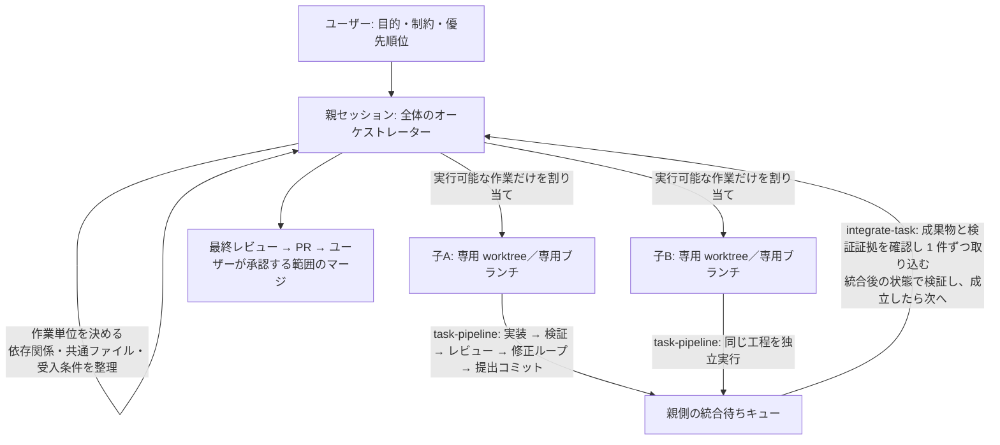

# 並列開発のオーケストレーション（親セッション用）

親セッション（あなた）が「全体のオーケストレーター」として並列開発を回すための手順書です。
子セッション側の工程は `task-pipeline` ワークフロー、統合待ちキューは `integrate-task` ワークフローが担当します。

## 1. 登場人物と道具

| 役割 | 誰が | 使うもの |
| --- | --- | --- |
| 目的・制約・優先順位 | ユーザー | 会話 |
| 作業単位の決定、依存関係・共通ファイル・受入条件の整理、割り当て、統合、最終レビュー、PR | 親セッション（あなた） | `create_session` / `send_session_message` / `get_sessions_status` / `run_dynamic_workflow`（`integrate-task`）/ `gh pr create` |
| 1 作業単位の実装〜提出 | 子セッション（専用 worktree／専用ブランチ） | `run_dynamic_workflow`（`task-pipeline`）または `copilot workflow run task-pipeline` |



## 2. 手順

### 0. 前提を実測する

- `dynamic_workflows_manage` の `list` に `task-pipeline` と `integrate-task` が見えること（見えなければ `.github/extensions/integrate-task/` の状態を疑う）。
- 統合先ブランチに `.github/integrate-task.policy.json` がコミット済みであること。検証コマンドはここが正本:
  `node .github/extensions/integrate-task/integrate/cli.mjs policy`
- 親の作業ツリーが clean であること（統合はここで進む）。
- **子の worktree にもこの拡張とスキルが入ること。** 子の worktree は既定ブランチから作られるので、
  道具立て（`.github/extensions/integrate-task/`・`.github/skills/`）が既定ブランチにコミット済みでないと、
  子は `task-pipeline` を実行できない。未コミットなら先にコミットするか、子に `extensions_reload` を促す（未検証の回避策）。

### 1. 統合ブランチを用意する

親の作業ツリーで統合ブランチを切る（以降、統合はこのブランチへ 1 件ずつ入る）。

```
git switch -c agent-integration/<run>      # 既にあれば switch だけ
```

### 2. 作業単位を決める（人間に列挙させない）

- 受入条件の正本は `docs/demo/ACCEPTANCE.md`。ここから「独立して検証できる単位」へ切り分ける。
- 各単位に次を決める。
  - `taskId`: 英数字で始まる短い ID（例 `T1`）
  - `title`: 短い名前
  - `prompt`: 受入条件（子の実装役とレビュー役の両方に渡る。何を作り、何を満たせば完了かを具体的に）
  - `verify`: 検証コマンド（省略時はポリシーの verify）
- 表にして整理する: 依存関係 / 共通ファイル / 統合の順序。
- **同じファイルを触る単位は直列化する。** 依存が満たされていない単位は割り当てない。
- 並列数は 2〜3 から始める。最初の 1 件は `mode: "interactive"` で流れを確認すると安全。

### 3. 子セッションを作る

`create_session` の例（1 単位につき 1 つ）。

- `name`: `T1: <短い名前>`
- `kickoff.model` / `kickoff.reasoning_effort`: 子セッション自身（図の「責任者」）のモデルと推論強度。
  選べるモデルは環境で異なるため、この環境で使えるものを指定する（`task-pipeline` の `roles` は
  その中の実装役・レビュー役の能力を決める、別の指定）。
- `workspace_type`: `"worktree"`（専用 worktree／専用ブランチ）
- `base_branch`: **指定しない**。子の worktree は既定ブランチから作られるため、統合ブランチからの分岐は
  子の手順 2（`git switch -c agent/<taskId> <統合ブランチ>`）で行う。ローカルブランチを `base_branch` に
  指定できるかは未検証なので、この手順では使わない。
- `kickoff.mode`: `"autopilot"`（子は親に判断を仰ぐ設計なので、人間の承認待ちで止めない）
- `kickoff.prompt`: 下のテンプレート
- `notify_on_idle`: `"once"`（子が idle になったら通知を受ける）
- `coordinate_with_creator`: `true`（子が親へ報告できるようにする）

### 4. 子の kickoff テンプレート（`<...>` を埋めてそのまま渡す）

```
あなたは作業単位 <taskId>「<title>」の責任者です。専用 worktree／専用ブランチで、この 1 単位だけを完成させてください。

## 受入条件
<prompt>

## 手順
1. 専用 worktree であることを確認する（`git rev-parse --git-dir` と `git rev-parse --git-common-dir` が違うパスなら linked worktree）。違えば作業を始めず親へ報告する。
2. 統合ブランチ <統合ブランチ> から自分の作業ブランチを切る: `git switch -c agent/<taskId> <統合ブランチ>`。`git status` が clean であることを確認する（汚れていれば親へ報告する）。
3. `run_dynamic_workflow` を name="task-pipeline" で起動する。args は次の形（roles はこのセッションで使えるモデル・推論強度に合わせる。省略するとセッション既定になる）:
   {"taskId":"<taskId>","title":"<title>","prompt":"<prompt>","roles":{"implementer":{"reasoningEffort":"medium"},"reviewer":{"reasoningEffort":"high"}},"maxReworks":2}
4. 実行は数分以上かかる。run ID が返るので、結果は `dynamic_workflows_manage` の `inspect-run` で読む。CLI から起動すると 1 コマンドで完了まで待てる（args ファイルは**作業ツリーの外**に置く。作業ツリーに置くと提出コミットに混ざる）:
   copilot workflow run task-pipeline --args @<作業ツリー外>/task.json --result-file <作業ツリー外>/result.json --silent --output-format json
5. state が SUBMITTED なら親へ次を送る: taskId / state / submittedHead / branch / files / attempts / verify.ok / review.verdict / evidenceRef / worktree と、変更の要約・検証で確認できたこと・できなかったこと。
6. state が NEEDS_PARENT なら detail と message を添えて親に判断を仰ぐ。勝手に受入条件を変えない。

## 禁止
- 統合ブランチや main へのマージ、push、PR 作成（親の仕事）。
- 検証・テストの削除や弱体化、受入条件の変更。
- 他の作業単位のファイルの変更、作業ツリーの外の変更。
- Docker / コンテナー / SQL Server / LocalDB / Azure の使用。
```

### 5. 子の報告を待つ

- `get_sessions_status` で子の状態を見る（busy / idle / awaiting_input）。
- `notify_on_idle: "once"` を付けた子は idle になった時点で通知が届く。
- 子が `awaiting_input` なら、ユーザーに判断を仰ぐべき内容かを確認し、必要なら `answer_session_input` で答える。
- 子から `NEEDS_PARENT` の報告が来たら、受入条件の変更が必要なものはユーザーへ回す。

### 6. 統合待ちキューへ 1 件ずつ取り込む

- 受付の前に、子の報告（`submittedHead` / `files` / `verify.ok` / `review.verdict` / `evidenceRef`）を確認する。
  証拠は `<home>/evidence/task/<taskId>/<連番>/` にあり、`result.json` に検証とレビューの結果が入っている。
  気になる点があれば統合せず、子へ修正を指示する（`send_session_message`）。
- 受付は 1 件ずつ。複数を同時に `apply` しない。

1. 受付を登録する（子の `submittedHead` を固定し、ポリシーのハッシュを記録する）。1 行で実行する
   （シェルの行継続は環境で異なるため使わない）:

```
node .github/extensions/integrate-task/integrate/cli.mjs register --operation-id <operationId> --submitted <子の submittedHead> --repo <親の作業ツリー> --target-branch <統合ブランチ> --child-session <子セッション ID>
```

2. 検証まで実行する: `run_dynamic_workflow` name="integrate-task" args=`{"operationId":"<operationId>","mode":"check"}`
3. `VERIFIED_NOT_PUBLISHED` なら `mode:"apply"` で統合ブランチへ反映する。
4. それ以外は理由コードごとに親が解消してから再実行する。

子の worktree は同じリポジトリの linked worktree なので、提出コミットは親の作業ツリーからそのまま参照できる。

| state / detail | 親の動き |
| --- | --- |
| `NEEDS_PARENT` + `dependency-not-integrated` | 依存する作業単位を先に統合する |
| `NEEDS_PARENT` + `guard-path-touched` | guardPaths の変更は親が内容を判断して手で入れる |
| `NEEDS_PARENT` + `merge-conflict` | 子に統合ブランチの取り込みを指示し、新しい提出コミットで再提出させる |
| `STALE_TARGET` | 統合ブランチが動いた。もう一度 `check` する |
| `BLOCKED` | `target-busy` / `target-git-operation` を解消する |
| `INTEGRATED` | 完了。次の単位へ進む |

### 7. 最終レビュー → PR → ユーザーが承認する範囲のマージ

- すべての単位が `INTEGRATED` になったら、統合ブランチ全体を受入条件と突き合わせてレビューする。
- PR はユーザーに確認してから作る: `gh pr create --base <既定ブランチ> --head <統合ブランチ>`
- マージは**ユーザーが承認した範囲でのみ**実行する。勝手にマージしない・push しない。

## 3. 記録の原則

- 実測した事実だけを書く。成功・失敗・未実施を区別する。
- 残すもの: 使ったコマンド、終了コード、state、submittedHead、evidenceRef、統合コミット。
- ログに認証情報や不要な個人情報を保存しない。

## 4. 未検証（このスキルを使いながら確かめる）

- `create_session` の `base_branch` にローカル統合ブランチを指定できるか（この手順では使わない）。
- 子セッションの完了通知（`notify_on_idle`）の到達。
- `run_dynamic_workflow` の完了通知（結果は `dynamic_workflows_manage` の `inspect-run` で読む。CLI の `copilot workflow run` は完了まで待てることを実測済み）。
- 子が worktree 作成後に `extensions_reload` で拡張を読み直せるか（道具立てが既定ブランチに無い場合の回避策）。
